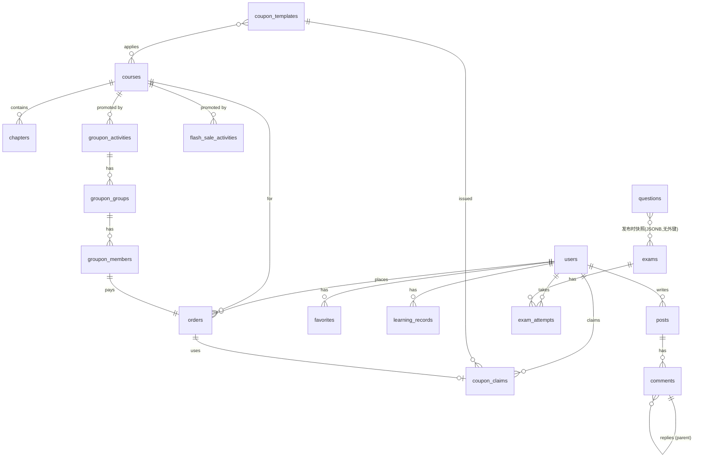

# 知序课堂 后端接口设计文档

| 项 | 说明 |
| --- | --- |
| 依据 | 根目录 `项目说明文档.md`（权威）、`frontend/需求描述.txt`（原始需求） |
| 定位 | **生产级**后端，承接一期纯前端演示，替换 `localStorage` 持久化 |
| 支付 | **模拟支付 / 模拟退款**，但抽象为可替换的支付网关接口，预留真实支付接入 |
| 角色 | 游客、普通用户（`user`）、管理员（`admin`） |
| 金额 | 一律整数「分」存储与计算，展示层格式化 |
| 时间 | 存储 UTC（`timestamptz`），展示按 `Asia/Shanghai`；倒计时/到期以**服务端时间**为准 |
| 决策点 | 文中以 `【决策点 D#】` 标记，汇总见 §14，由你拍板 |

> 阅读建议：先看 §14 决策点汇总与 §13「你可能没考虑到的点」，再回头读对应章节。接口清单见 §7，数据安全见 §10。

---

## 1. 范围与目标

### 1.1 功能范围（对齐项目说明文档）

认证与账号、课程浏览/详情/学习/收藏、课程管理（草稿/发布/下架 + 章节）、优惠券（模板 + 领取记录）、订单与模拟支付、拼团（活动/团组/成团/失败退款）、秒杀（库存/限购）、题库与考试（快照/一次提交/服务端判分）、学习社区（帖子/两层评论/点赞/屏蔽词）、用户中心、管理端工作台。

### 1.2 非功能目标（生产级）

- **安全**：认证鉴权、防越权、防注入/XSS/CSRF、敏感数据保护、限流防刷、审计。
- **并发正确性**：秒杀防超卖、拼团成团原子性、领券/下单幂等、乐观锁替代前端跨标签页互斥。
- **可审计 / 合规**：操作审计日志、个人信息保护（PIPL）、账号注销。
- **可恢复**：备份与恢复（RPO/RTO）、软删除。
- **可观测**：结构化日志、指标、健康检查、告警。

### 1.3 明确不做（继承一期排除项）

直播、专栏、电子书、绑定手机号、SSR/SEO、多语言、私信/关注/举报、真实支付（本期模拟）。
**注意**：一期排除的「忘记密码、邮件验证、真实文件上传、真实安全控制」在生产级定位下需要重新评估：真实安全控制已纳入本设计（§10），其余见 §13 与决策点 D7（邮箱验证/找回密码）、D9（真实文件存储）。

---

## 2. 总体架构

### 2.1 架构形态对比 【决策点 D1 · 已决：模块化单体 + 独立 Worker】

| 维度 | A. 模块化单体（推荐） | B. 微服务 | C. 单体 + 独立任务 Worker |
| --- | --- | --- | --- |
| 复杂度 | 低，单部署单元 | 高，服务拆分/注册/网关/分布式事务 | 中，API 与定时任务进程分离 |
| 运维成本 | 低 | 高（需容器编排、链路追踪） | 中 |
| 扩展性 | 水平扩容多实例即可 | 按服务独立扩容 | 计算/任务分离 |
| 事务一致性 | 单库事务，简单 | 跨服务 saga，复杂 | 单库事务 |
| 适用规模 | 中小团队、本业务边界清晰 | 大团队、多业务线 | 需要独立伸缩定时任务 |
| 风险 | 模块边界需自律 | 过度设计、运维负担 | 进程间协调 |

**推荐 A（模块化单体）+ 独立定时任务进程**：本业务域边界清晰、单团队维护，微服务带来的分布式事务与运维成本远超收益。按领域划分模块（auth/catalog/trade/promotion/exam/community/iam/audit），模块间通过内部接口调用，共享一个数据库。定时任务（拼团到期、券过期、活动状态流转）独立进程运行，避免与 API 抢资源。规模上来后可平滑拆出 trade/promotion 服务。

### 2.2 部署拓扑（推荐）

```text
            ┌─────────────┐
 浏览器 ───▶│ Nginx/网关   │  TLS 终止、限流、静态资源、反向代理
            └──────┬──────┘
                   │
        ┌──────────┴───────────┐
        ▼                      ▼
 ┌─────────────┐        ┌─────────────┐
 │ API 实例 ×N  │        │ 任务 Worker  │  定时扫描/延迟队列消费
 └──────┬──────┘        └──────┬──────┘
        │                      │
        ├──────────┬───────────┼─────────────┐
        ▼          ▼           ▼             ▼
 ┌──────────┐ ┌────────┐ ┌──────────┐ ┌──────────┐
 │PostgreSQL│ │ Redis  │ │对象存储   │ │日志/指标  │
 │主+从/备份│ │缓存/锁 │ │MinIO/OSS │ │集中采集   │
 └──────────┘ └────────┘ └──────────┘ └──────────┘
```

- **Nginx**：TLS、全局限流、上传体积限制、 gzip、转发 `X-Request-Id`。
- **API 无状态多实例**：会话/锁/库存放 Redis，实例可水平扩容。
- **Redis**：会话吊销、限流计数、秒杀库存预扣、分布式锁、幂等键、热点缓存。
- **对象存储**：课程封面、富文本图片、头像、视频/音频（见 D9）。
- **任务 Worker**：到期处理、状态流转、退款补偿。

### 2.3 环境划分

`dev` / `staging` / `prod` 三套独立配置与数据库；密钥经环境变量/密钥管理注入，**严禁入库入代码**；种子数据（演示账号、`course-typescript` 等）仅在 dev/staging 注入，prod 用初始化管理员流程（见 §4.4）。

---

## 3. 技术栈选型

### 3.1 语言与框架对比 【决策点 D2 · 已决：NestJS + Prisma】

| 维度 | Node.js + NestJS (TS) | Java + Spring Boot | Python + FastAPI | Go + Gin |
| --- | --- | --- | --- | --- |
| 与前端类型共享 | ★★★（同为 TS，可共享 DTO/枚举） | ★ | ★ | ★ |
| 开发效率（CRUD 密集） | 高 | 中（样板多） | 高 | 中 |
| 并发/性能 | I/O 强，CPU 弱（单线程） | 强（虚拟线程） | 中（GIL） | 强 |
| 企业生态/安全组件 | 成长中 | 最成熟（Spring Security） | 中 | 中 |
| 事务/ORM | Prisma/TypeORM | JPA/MyBatis-Plus | SQLAlchemy | GORM/sqlc |
| 部署/资源 | 中 | 较重（JVM） | 中 | 轻（单二进制） |
| 国内生产普及度 | 中 | 高 | 中 | 中 |
| 招聘/可维护性 | 前端转后端友好 | 后端人才多 | AI/脚本友好 | 云原生友好 |

**推荐**：
- 若你以 TypeScript 全栈为主、追求与前端的类型一致和开发速度 → **NestJS + Prisma + PostgreSQL**。
- 若更看重生产稳健、成熟安全生态与团队可维护性 → **Spring Boot + MyBatis-Plus/JPA + PostgreSQL**。

**【已决】选定 NestJS + Prisma**（TypeScript 全栈、与前端类型一致、CRUD 开发快；数据库为 PostgreSQL，D3 已决）。上表保留作选型依据存档；本文接口与数据模型与语言无关。

### 3.2 数据库对比 【决策点 D3 · 已决：PostgreSQL】

| 维度 | PostgreSQL（推荐） | MySQL |
| --- | --- | --- |
| 复杂约束/部分索引 | 强（部分唯一索引利于幂等/限领） | 较弱 |
| JSONB（考试快照、富文本） | 原生高效 | JSON 支持一般 |
| 事务/并发（MVCC） | 成熟 | 成熟（InnoDB） |
| 国内运维熟悉度 | 上升中 | 高 |
| 全文检索 | 内置 | 需外挂 |

**推荐 PostgreSQL**：考试题目快照用 JSONB、领券限领/幂等用部分唯一索引、复杂状态查询更顺手。若团队 MySQL 经验更深，MySQL 8 亦可，设计不变。

### 3.3 缓存与分布式设施

**Redis（必需）** 用途：会话吊销集合、登录限流、秒杀库存预扣减、分布式锁（成团/领券）、幂等键结果缓存、课程详情热点缓存。生产建议主从 + 哨兵或托管 Redis。

### 3.4 任务调度 / 消息队列对比 【决策点 D4 · 已决：DB 定时扫描】

| 方案 | 说明 | 适用 |
| --- | --- | --- |
| A. DB 定时扫描（推荐） | Worker 周期扫描到期活动/券/团组，事务处理 | 本规模，简单可靠 |
| B. Redis 延迟队列 | BullMQ/asynq 精确定时触发 | 需秒级精确到期 |
| C. RabbitMQ/Kafka | 独立 MQ，削峰/解耦 | 高吞吐、多消费者 |

**推荐 A**：拼团/秒杀到期对秒级精度不敏感（分钟级扫描足够），DB 扫描 + 状态机最简单且不易丢任务。库存预扣等热路径仍走 Redis。未来吞吐上来再升级 B/C。

### 3.5 对象存储对比 【决策点 D9 · 已决：MinIO 自建（私有化）】

| 方案 | 说明 |
| --- | --- |
| MinIO 自建 | S3 兼容、数据自主、需自运维。**【已决】** |
| 云 OSS（阿里云/腾讯云） | 免运维、CDN 一体、按量付费 |

统一走 S3 协议抽象（MinIO 原生兼容），便于未来切换云 OSS。

### 3.6 ORM

**Prisma**（随 D2 已决）：类型安全、迁移友好。要求：参数化查询防注入、迁移版本化、连接池。

---

## 4. 认证与授权

### 4.1 会话方案对比 【决策点 D5 · 已决：Session + Redis】

| 维度 | A. Session + Redis（推荐） | B. JWT access + refresh | C. 纯短时效 JWT |
| --- | --- | --- | --- |
| 即时吊销（退出/改密） | ★★★ 删 Redis 即失效 | ★★ refresh  rotation + 黑名单 | ★ 难即时吊销 |
| 无状态/水平扩展 | 依赖 Redis（已必需） | access 无状态 | 无状态 |
| 实现复杂度 | 低 | 中（刷新轮换） | 低 |
| CSRF 防护 | 需（Cookie） | 若 Cookie 存需；Header 存免 | 同左 |
| 多端/移动端未来 | 一般 | 好 | 好 |

**推荐 A（Session + Redis，HttpOnly + Secure + SameSite=Lax Cookie）**：
- 项目说明文档要求「修改密码成功后需重新登录」「退出清除会话」——Session 方案天然支持**即时全端吊销**，最契合。
- Redis 本就必需，无额外基础设施。
- 空闲超时：`SESSION_TTL` 默认 1800 秒，管理员与普通用户一致；Redis 会话与 Cookie 均为严格 30 分钟空闲窗口，普通接口请求不续期（关闭滚动续期与 store touch），仅登录与 `POST /auth/heartbeat` 显式续期。前端按真实交互（指针、键盘、滚动、触摸、切回前台、音视频播放）以 60 秒节流发送心跳，空闲页面不发请求，实现「无操作 30 分钟重新登录」。
- 若未来有移动端/开放 API 需求，再引入 B（JWT）作为补充。

### 4.2 授权模型（RBAC）

- 三角色：`guest`（无会话）、`user`、`admin`。角色存于账号，不由登录页选择。
- 服务端中间件按路由元信息校验：未登录→`401`；角色不符→`403`。
- **管理端 API 独立前缀 `/api/v1/admin/*`**，仅 `admin` 可访问；用户端资源接口对每个资源做**归属校验**（防 IDOR，见 §10）。
- 管理员不参与用户端购买/学习流程（与说明文档一致）。

### 4.3 登录安全

- 邮箱或密码错误**统一提示**「邮箱或密码错误」，不泄露账号是否存在。
- 会话空闲超时：连续 30 分钟无真实交互即失效；续期只由登录与心跳接口触发，后台轮询、页面停留等非交互请求不延长会话。会话失效后的下一次请求返回 `2001`，前端跳转登录页并提示重新登录。
- 登录限流：按 IP + 账号双维度（如 5 次/分钟，失败递增锁），Redis 计数。
- 密码哈希存储（见 §10.2），绝不明文/可逆。
- 注册不自动登录（与说明文档一致）。

### 4.4 管理员账号安全

- 一期演示弱口令 `admin@example.com / abc12345` **不得带入 prod**。
- prod 通过初始化命令创建管理员，强制强密码（或首登强制改密），凭据经密钥管理注入。
- 管理端登录额外限流；可选 2FA（见 D8）。

### 4.5 密码策略 【决策点 D6 · 已决：升级强度】

说明文档规定「固定 8 位、字母 + 数字」，该强度对生产偏弱，已决定升级。
- **【已决】服务端放宽为 8–64 位、鼓励大小写/数字/符号混合；前端校验同步升级。**
- 原固定 8 位字母数字规则仅保留在一期前端演示中，不进入后端实现。

### 4.6 邮箱验证与忘记密码 【决策点 D7 · 已决：暂不纳入】

一期排除邮件验证/忘记密码，**本期维持排除**，已明确接受以下风险：
- 用户无法自助找回密码，需人工客服兜底；
- 注册邮箱真实性无保障，靠注册限流防批量注册。
待接入邮件服务后再补验证链接与一次性重置 token（§7.1 接口已预留）。

### 4.7 可选加固 【决策点 D8 · 已决：不启用 2FA】

- **【已决】管理员与普通用户均仅凭邮箱密码登录，不启用二次验证。**
- 异常登录通知、会话设备管理暂不做，后续按需补充。

---

## 5. API 设计规范

- **风格**：RESTful，资源名词复数；版本前缀 `/api/v1`。
- **统一响应包**：

```json
{ "code": 0, "message": "ok", "data": {}, "requestId": "req-xxx" }
```

`code=0` 成功；非 0 为业务错误码（见下表）；HTTP 状态码语义化（200/201/400/401/403/404/409/422/429/500）。

- **错误码（示例，分段）**：

| 段 | 含义 | 示例 |
| --- | --- | --- |
| 1xxx | 通用/参数 | 1001 参数校验失败、1002 资源不存在、1003 请求方法不允许、1004 请求内容过大、1005 请求过于频繁、1006 服务器内部错误 |
| 2xxx | 认证/授权 | 2001 未登录、2002 无权、2003 凭据错误 |
| 3xxx | 课程/学习 | 3001 课程不存在、3002 未购买 |
| 4xxx | 交易/券 | 4001 库存不足、4002 券不可用、4003 重复购买、4004 幂等冲突 |
| 5xxx | 拼团/秒杀 | 5001 团已满、5002 活动未开始、5003 限购 |
| 6xxx | 考试 | 6001 已提交、6002 考试已结束 |
| 7xxx | 社区 | 7001 命中屏蔽词（附命中词列表） |

- **框架异常映射**：业务异常一律抛 `BizException(code, message, httpStatus)`，原样映射。框架自身抛出的 HTTP 异常（路由不匹配、方法不允许、请求体超限等）**保留其原 HTTP 状态**，code 按下表取；未列出的 4xx 取 1001、5xx 取 1006。非 HTTP 的未知异常统一 500 / 1006，message 固定「服务器开小差了，请稍后重试」，原始错误只进日志。

| HTTP 状态 | code |
| --- | --- |
| 400 | 1001 参数校验失败 |
| 401 | 2001 未登录 |
| 403 | 2002 无权 |
| 404 | 1002 资源不存在 |
| 405 | 1003 请求方法不允许 |
| 413 | 1004 请求内容过大 |
| 429 | 1005 请求过于频繁 |
| 500 | 1006 服务器内部错误 |

- **分页**：`page`（从 1）、`pageSize`（默认 20，最大 100）；响应 `{ items, total, page, pageSize }`。
- **幂等**：创建类 POST（下单/领券/参团/发帖/秒杀）要求 `Idempotency-Key` 请求头，服务端缓存结果，重复请求返回首次结果（见 §9）。
- **时间**：响应 ISO 8601 UTC；客户端按 `Asia/Shanghai` 展示。
- **金额**：整数分（`priceCents`），响应附展示用格式化字段可选。
- **请求追踪**：网关生成 `X-Request-Id`，贯穿日志。
- **乐观锁**：管理端编辑携带 `version`，冲突返回 `409`（替代前端跨标签页互斥）。

---

## 6. 数据模型

### 6.1 ER 概览



### 6.2 核心表（关键字段与约束）

| 表 | 关键字段 | 约束/索引 |
| --- | --- | --- |
| `users` | id, email, password_hash, nickname, avatar_url, gender, role, status, email_verified_at, version | email 唯一；role∈{user,admin} |
| `courses` | id, name, type, cover_url, intro, detail_rich, instructor, original_cents, sale_cents, status, version | type∈{video,audio,rich}；status∈{draft,published,unpublished}；sale≤original |
| `chapters` | id, course_id, title, content_type, content_ref/rich, sort_order | (course_id,sort_order) 唯一；类型须与课程一致 |
| `orders` | id, order_no, user_id, course_id, activity_type, activity_id, original_cents, current_cents, discount_cents, paid_cents, coupon_claim_id, status, paid_at, version | order_no 唯一；部分唯一索引 `(user_id,course_id) WHERE status IN ('pending','paid')`→防重复购买（退款/取消后可再购）；秒杀限购部分唯一索引 `(user_id,activity_id) WHERE activity_type='flash_sale' AND status IN ('pending','paid')`；status∈{pending,paid,refunded,cancelled} |
| `payments` | id, order_id, channel='mock', amount_cents, status, transaction_no | 抽象支付网关，预留真实渠道 |
| `coupon_templates` | id, name, discount_cents, start_at, end_at, total_qty, per_user_limit, status, version | status∈{disabled,enabled}；适用课程关联表 |
| `coupon_template_courses` | template_id, course_id | 复合主键 |
| `coupon_claims` | id, template_id, user_id, status, claimed_at, used_at, order_id | status∈{unused,used,restored,invalid,expired}；限领唯一约束（见 §9） |
| `groupon_activities` | id, course_id, name, price_cents, target_size, start_at, end_at, status | 同课程时间不重叠（排除约束）；status∈{not_started,ongoing,ended,cancelled} |
| `groupon_groups` | id, activity_id, status, member_count, formed_at, expires_at | status∈{pending,success,failed} |
| `groupon_members` | id, group_id, user_id, order_id, joined_at | (activity_id,user_id) 唯一→一人一次；(group_id,user_id) 唯一 |
| `flash_sale_activities` | id, course_id, name, price_cents, stock, sold, start_at, end_at, status | stock≥sold；限购由 orders 部分唯一索引保证（见 orders 行） |
| `questions` | id, type, stem, options(jsonb), answer(jsonb), analysis, score, status | type∈{single,multiple}；单选 1 答案、多选≥2；分值创建后不可改 |
| `exams` | id, title, description, duration_min, pass_score, status, snapshot(jsonb) | status∈{draft,published,ended}；pass≤总分 |
| `exam_attempts` | id, exam_id, user_id, started_at, deadline_at, submitted_at, score, answers(jsonb) | (exam_id,user_id) 唯一→一次正式提交 |
| `posts` | id, user_id, content, like_count, created_at | 无标题/分类 |
| `comments` | id, post_id, user_id, parent_id, reply_to_user_id, content | parent_id 仅两级；删一级级联删回复 |
| `post_likes` | post_id, user_id | 复合主键 |
| `blocked_words` | id, word, status | 包含匹配、忽略大小写 |
| `favorites` | user_id, course_id | 复合主键；仅课程 |
| `learning_records` | user_id, course_id, chapter_id, visited_at | 进度按已访问章节计算 |
| `audit_logs` | id, actor_id, action, target, before/after(jsonb), ip, request_id, created_at | 管理端写操作留痕 |
| `idempotency_keys` | key, user_id, endpoint, response(jsonb), created_at | (user_id,key,endpoint) 唯一 |

### 6.3 关键状态机

- **课程**：`draft → published → unpublished`（可重新发布）；编辑权限按状态矩阵（见说明文档 §3.3）。
- **订单**：`pending → paid`（模拟支付成功）；拼团失败 `paid → refunded`；超时未支付 `pending → cancelled`（释放库存/券）。
- **拼团团组**：`pending → success`（满员）/ `pending → failed`（到期未满）。
- **优惠券领取**：`unused → used`（下单核销）/`unused → restored`（退款恢复）/`unused|restored → invalid`（模板停用）/`unused → expired`（到期）。
- **考试**：`draft → published → ended`；提交快照在发布时冻结。

---

## 7. 接口清单

> 权限列：`公开`=游客可访问；`user`=普通用户；`admin`=管理员。所有写操作受 §9 幂等/并发与 §10 安全约束。

### 7.1 认证与账号

| 方法 | 路径 | 权限 | 说明 |
| --- | --- | --- | --- |
| POST | `/api/v1/auth/register` | 公开 | 注册（邮箱/密码/昵称），不自动登录 |
| POST | `/api/v1/auth/login` | 公开 | 登录，统一错误提示，返回角色 |
| POST | `/api/v1/auth/logout` | 登录 | 退出，吊销会话 |
| GET | `/api/v1/auth/me` | 登录 | 当前用户信息 |
| POST | `/api/v1/auth/heartbeat` | 登录 | 会话心跳：真实交互时重置 30 分钟空闲窗口，返回 `200` |
| POST | `/api/v1/auth/password` | 登录 | 改密（校验旧密码），成功后吊销全部会话 |
| POST | `/api/v1/auth/verify-email` | 公开 | 邮箱验证（D7 已决暂不启用，**预留**） |
| POST | `/api/v1/auth/forgot-password` | 公开 | 发起重置（D7 已决暂不启用，**预留**） |
| POST | `/api/v1/auth/reset-password` | 公开 | 一次性 token 重置（D7 已决暂不启用，**预留**） |

### 7.2 课程浏览与学习（用户端）

| 方法 | 路径 | 权限 | 说明 |
| --- | --- | --- | --- |
| GET | `/api/v1/home/recommendations` | 公开 | 首页推荐 |
| GET | `/api/v1/courses` | 公开 | 已发布课程列表（分页/筛选） |
| GET | `/api/v1/courses/:id` | 公开 | 详情：含活动信息、可领券、章节目录（含试看标记） |
| GET | `/api/v1/courses/:id/chapters/:cid/content` | 公开 | 章节正文：免费章节与免费课程公开；付费章节需登录且已购买（游客 401，未购 403） |
| POST | `/api/v1/learning/:courseId/chapters/:cid/visit` | user | 记录章节访问（免费章节/免费课程登录后可上报，游客不可上报），重算进度/已学完 |
| GET | `/api/v1/user/study-records` | user | 学习记录（已学 ∪ 已购，已购未观看进度 0%） |
| POST | `/api/v1/favorites` | user | 收藏课程 |
| DELETE | `/api/v1/favorites/:courseId` | user | 取消收藏 |
| GET | `/api/v1/user/favorites` | user | 我的收藏 |

### 7.3 课程管理（管理端）

| 方法 | 路径 | 权限 | 说明 |
| --- | --- | --- | --- |
| GET | `/api/v1/admin/courses` | admin | 全部状态列表（含报名人数/活动标记） |
| POST | `/api/v1/admin/courses` | admin | 创建（草稿），首章保存后锁类型 |
| GET | `/api/v1/admin/courses/:id` | admin | 详情（含草稿/下架） |
| PUT | `/api/v1/admin/courses/:id` | admin | 编辑基本信息（按状态矩阵 + version） |
| POST | `/api/v1/admin/courses/:id/publish` | admin | 发布/重新发布（至少 1 个章节） |
| POST | `/api/v1/admin/courses/:id/unpublish` | admin | 下架 |
| POST | `/api/v1/admin/courses/:id/chapters` | admin | 新增章节（正文必填；`isFree?: boolean` 免费试看，默认 false） |
| PUT | `/api/v1/admin/courses/:id/chapters/:cid` | admin | 编辑章节（正文传入时不可为空；`isFree?: boolean` 传入即设置） |
| DELETE | `/api/v1/admin/courses/:id/chapters/:cid` | admin | 删除章节 |
| POST | `/api/v1/admin/courses/:id/chapters/reorder` | admin | 上移/下移/排序，重编号 |

### 7.4 优惠券

| 方法 | 路径 | 权限 | 说明 |
| --- | --- | --- | --- |
| GET | `/api/v1/courses/:id/coupons` | 公开 | 课程详情可领券列表 |
| POST | `/api/v1/coupons/:templateId/claim` | user | 领取（幂等 + 限领校验） |
| GET | `/api/v1/user/coupons` | user | 我的券（按状态筛选） |
| GET | `/api/v1/admin/coupons` | admin | 模板列表 |
| POST | `/api/v1/admin/coupons` | admin | 创建（默认不启用） |
| GET | `/api/v1/admin/coupons/:id` | admin | 详情 |
| PUT | `/api/v1/admin/coupons/:id` | admin | 编辑（仅停用态可改全部字段） |
| POST | `/api/v1/admin/coupons/:id/enable` | admin | 启用 |
| POST | `/api/v1/admin/coupons/:id/disable` | admin | 停用（级联未使用/已恢复→已失效） |

### 7.5 订单与模拟支付

| 方法 | 路径 | 权限 | 说明 |
| --- | --- | --- | --- |
| GET | `/api/v1/checkout/:courseId/preview` | user | 价格预览（query: couponId, activityType, activityId），服务端计价 |
| POST | `/api/v1/orders` | user | 创建订单（幂等键；服务端定价；核销券；防重复购买） |
| POST | `/api/v1/orders/:id/pay` | user | 模拟支付（幂等；成功后扣库存/计团/授权） |
| GET | `/api/v1/orders/:id` | user | 订单详情/支付结果（归属校验） |
| GET | `/api/v1/user/orders` | user | 购买记录（仅自己） |
| GET | `/api/v1/admin/orders` | admin | 全部订单（客服/审计） |

### 7.6 拼团

| 方法 | 路径 | 权限 | 说明 |
| --- | --- | --- | --- |
| GET | `/api/v1/groupons` | 公开 | 活动列表（仅进行中且未结束） |
| GET | `/api/v1/groupons/:id` | 公开 | 详情 + 待成团团组 |
| POST | `/api/v1/groupons/:id/groups` | user | 发起新团（幂等；发起者为首成员；生成订单） |
| POST | `/api/v1/groupons/:id/groups/:gid/join` | user | 加入待成团团（幂等；生成订单） |
| GET | `/api/v1/user/groupons` | user | 我的拼团 |
| GET | `/api/v1/admin/groupons` | admin | 活动列表 |
| POST | `/api/v1/admin/groupons` | admin | 创建（仅已发布课程；时间不重叠） |
| PUT | `/api/v1/admin/groupons/:id` | admin | 编辑（仅未开始） |
| POST | `/api/v1/admin/groupons/:id/cancel` | admin | 取消（仅未开始） |

### 7.7 秒杀

| 方法 | 路径 | 权限 | 说明 |
| --- | --- | --- | --- |
| GET | `/api/v1/flash-sales` | 公开 | 活动列表（仅进行中且未结束） |
| GET | `/api/v1/flash-sales/:id` | 公开 | 详情（总/剩余库存、倒计时） |
| POST | `/api/v1/flash-sales/:id/purchase` | user | 秒杀下单（幂等 + 限购 + 防超卖；生成订单） |
| GET | `/api/v1/admin/flash-sales` | admin | 活动列表 |
| POST | `/api/v1/admin/flash-sales` | admin | 创建 |
| PUT | `/api/v1/admin/flash-sales/:id` | admin | 编辑（仅未开始；库存≥已售） |
| POST | `/api/v1/admin/flash-sales/:id/cancel` | admin | 取消（仅未开始） |

### 7.8 题库与考试

| 方法 | 路径 | 权限 | 说明 |
| --- | --- | --- | --- |
| GET/POST | `/api/v1/admin/questions` | admin | 题目列表/创建（分值仅创建时定） |
| GET/PUT | `/api/v1/admin/questions/:id` | admin | 详情/编辑（不可改分值） |
| POST | `/api/v1/admin/questions/:id/enable` | admin | 启用题目 |
| POST | `/api/v1/admin/questions/:id/disable` | admin | 停用题目 |
| GET/POST | `/api/v1/admin/exams` | admin | 考试列表/创建 |
| GET/PUT | `/api/v1/admin/exams/:id` | admin | 详情（含选题）/编辑（草稿） |
| POST | `/api/v1/admin/exams/:id/publish` | admin | 发布（冻结题目快照） |
| POST | `/api/v1/admin/exams/:id/end` | admin | 结束 |
| GET | `/api/v1/exams` | user | 已发布考试列表 |
| GET | `/api/v1/exams/:id` | user | 详情（**不含答案/解析**） |
| POST | `/api/v1/exams/:id/attempts` | user | 开始考试（唯一；返回题目快照无答案 + 服务端 deadline） |
| POST | `/api/v1/exams/:id/attempts/:aid/submit` | user | 交卷（幂等；服务端判分；支持提前/自动交卷） |
| GET | `/api/v1/exams/:id/attempts/:aid/result` | user | 成绩 + 解析（**交卷后**才返回答题详情） |
| GET | `/api/v1/user/exams` | user | 我的考试记录 |

### 7.9 学习社区与屏蔽词

| 方法 | 路径 | 权限 | 说明 |
| --- | --- | --- | --- |
| GET | `/api/v1/posts` | 公开 | 信息流 |
| GET | `/api/v1/posts/:id` | 公开 | 详情（两层评论） |
| POST | `/api/v1/posts` | user | 发帖（屏蔽词校验 + 幂等） |
| DELETE | `/api/v1/posts/:id` | user | 删除自己的帖子 |
| POST | `/api/v1/posts/:id/like` | user | 点赞 |
| DELETE | `/api/v1/posts/:id/like` | user | 取消点赞 |
| POST | `/api/v1/posts/:id/comments` | user | 一级评论（屏蔽词） |
| POST | `/api/v1/comments/:id/replies` | user | 回复（挂一级；屏蔽词） |
| DELETE | `/api/v1/comments/:id` | user | 删除自己的（一级级联删回复） |
| GET | `/api/v1/user/posts` | user | 我的帖子 |
| GET/POST | `/api/v1/admin/blocked-words` | admin | 屏蔽词列表/新增 |
| PUT/DELETE | `/api/v1/admin/blocked-words/:id` | admin | 启停/删除 |

### 7.10 用户中心与文件

| 方法 | 路径 | 权限 | 说明 |
| --- | --- | --- | --- |
| GET | `/api/v1/user/profile` | user | 资料（邮箱只读） |
| PUT | `/api/v1/user/profile` | user | 改昵称/头像/性别 |
| GET | `/api/v1/user/overview` | user | 学习概览统计 |
| POST | `/api/v1/files/upload` | 登录 | 图片上传（类型/大小校验，见 §10.9） |
| GET | `/api/v1/admin/dashboard/stats` | admin | 工作台统计 |
| DELETE | `/api/v1/user/account` | user | 注销账号【预留：D12 已决暂不启用】 |

---

## 8. 关键业务流程

### 8.1 下单 + 模拟支付

```text
1. POST /orders（Idempotency-Key）
   - 校验：课程已发布/未下架、未重复购买、活动有效、券适用且未使用且在有效期
   - 服务端计价：current = 售价/秒杀价/拼团价；paid = max(0, current - 券额)
   - 事务：创建 order(pending) + 核销券(unused→used) + 记录幂等结果
2. POST /orders/:id/pay（幂等）
   - 模拟支付网关返回成功 → 事务：order→paid、写 payments
   - 秒杀：扣库存（§9.1）；拼团：计团成员（§9.2）；普通：授予学习权限
3. 返回支付结果；学习权限以 order.paid 为准
```

### 8.2 拼团成团 / 失败

```text
支付成功 → 事务内 member_count+1（行锁）
  若满员 → group→success，全部成员订单授予学习权限
  若未满 → 保持 pending
Worker 扫描 expires_at 到期且 pending 的团：
  事务：group→failed；成员订单 paid→refunded（模拟退款）；
        恢复各自核销的券（used→restored）；不授予学习权限
```

### 8.3 考试提交判分

```text
POST attempts → 校验未考过/考试已发布 → 创建 attempt（唯一），
   返回题目快照（剥离 answer/analysis）+ 服务端 deadline_at
POST submit（幂等）→ 校验 deadline/未提交 → 服务端逐题比对：
   单选完全匹配得分；多选完全匹配且无错选才得分（无部分分）
   汇总 score，写 submitted_at → 交卷后 result 接口才返回答题详情与解析
倒计时自动交卷：客户端到点调用 submit；若客户端关闭/断网未调用，
   Worker 扫描 deadline 已过且未提交的 attempt 自动判分交卷（未答题计 0 分），
   服务端以 deadline 兜底拒绝一切超时提交
```

### 8.4 优惠券停用级联

```text
POST disable（version 乐观锁）→ 事务：template→disabled；
   该模板下 unused/restored 的 claims → invalid（永久）；
   used 保留；停用后不再出现在可领列表/不可结算；重新启用不恢复 invalid
```

---

## 9. 并发与一致性设计

### 9.1 秒杀防超卖

- 生产级采用「下单预占 → 支付确认扣减 → 超时释放」：比一期演示规则（支付成功后才扣库存）更强，避免多人同时拍下最后一件后都能支付成功。
- Redis 预扣：`DECR stock_key`，<0 则回补并返回「已售罄」；活动开始预热库存到 Redis。
- DB 兜底：支付成功时 `UPDATE ... SET sold=sold+1 WHERE id=? AND sold<stock`（乐观条件），失败则支付失败回滚 Redis 预占。
- 限购：orders 部分唯一索引 `(user_id,activity_id)` + 幂等键，防一人多单。
- 未支付超时取消订单并回补库存（见 §9.4）。

### 9.2 拼团成团原子性

- 计团在**单事务 + 团组行锁**（`SELECT ... FOR UPDATE`）内进行，避免并发满员判断竞态。
- `(activity_id,user_id)` 唯一约束保证一人一次；满员/结束的团拒绝加入。

### 9.3 领券限领与幂等

- 每模板每用户限领：部分唯一索引 `(template_id,user_id) WHERE status <> 'invalid'`（同一启用周期最多一条未失效记录）。
- **【已决】再领语义**：同一启用周期内，任何未失效记录（未使用/已使用/已过期）都阻止再领；仅当模板停用使记录变为「已失效」后才可重新领取；历史「已失效」记录不阻止领取。
- 创建字段含「每人限领数量」，但说明文档业务规则固定为每模板每人限领一张：`per_user_limit` 字段保留，本期服务端强制按 1 执行。
- 发放总量只统计未失效记录；用条件更新 `claimed_count < total_qty` 防超发。
- 幂等键防多标签页/重试重复领取。

### 9.4 订单超时与资源释放

- `pending` 订单设超时（如 15 分钟，模拟支付通常即时，但预留）；Worker 扫描超时→`cancelled`，释放预扣库存、恢复券。

### 9.5 幂等机制

- 创建类 POST 携带 `Idempotency-Key`；服务端 `(user_id,key,endpoint)` 唯一。
- 首次执行缓存响应；重复请求直接返回缓存结果；并发同键用锁/唯一约束串行化。

### 9.6 乐观锁替代跨标签页互斥

- 管理端课程/券/活动编辑携带 `version`；`UPDATE ... WHERE version=?` 失败返回 `409`，前端提示刷新。服务端天然解决多标签页覆盖。

---

## 10. 数据安全设计

### 10.1 传输安全
全站 HTTPS/TLS，HSTS；Cookie `Secure + HttpOnly + SameSite=Lax`；内网服务间最小权限。

### 10.2 密码存储 【决策点 D10 · 已决：bcrypt】

- **【已决】bcrypt，cost≥12**；加盐、不可逆。
- 禁止明文/可逆加密/弱哈希（MD5/SHA1）。

### 10.3 注入与 XSS
- **SQL 注入**：ORM 参数化查询，禁止字符串拼接 SQL。
- **存储型 XSS**：富文本（课程详细介绍、帖子）**服务端**白名单净化（如 sanitize-html/DOMPurify 服务端等价），剥离脚本/事件属性/危险 URL；粘贴 Word 清理 Office 标记与不安全内容；前端渲染再转义。表格限 20×20。
- **CSRF**：Session Cookie 方案配 SameSite + 同步 Token/双重提交 Cookie；状态变更用 POST/PUT/DELETE。

### 10.4 越权防护（IDOR）
- 垂直越权：`/admin/*` 仅 admin；路由中间件强制。
- 水平越权：订单/券/帖子/学习记录/考试记录按 `user_id` 归属校验，禁止仅凭 ID 访问他人资源。
- 章节正文接口：免费章节/免费课程公开；付费章节校验「已登录且已购买」，未购不泄露章节是否存在。

### 10.5 考试防作弊（答案泄露）
- 开始/详情接口**绝不返回正确答案与解析**；答案仅在**交卷后** result 接口返回。
- 服务端判分，不信任客户端分数；每用户每考试唯一一次正式提交。

### 10.6 价格与库存防篡改
- 价格一律**服务端计算**，客户端不传金额；券额/活动价服务端校验。
- 库存扣减服务端原子操作（§9.1），客户端库存仅展示。

### 10.7 限流与防暴力破解
- 网关全局限流 + 应用按 IP/账号细粒度限流（登录/注册/领券/秒杀/发帖）。
- 登录失败递增锁定；注册防批量（限流 + 可选邮箱验证 D7）。

### 10.8 敏感数据与隐私（PIPL）
- 最小化采集（仅邮箱/昵称/头像/性别）；邮箱展示脱敏；日志脱敏（不记密码/token/完整邮箱）。
- 敏感字段静态加密【决策点 D11 · 已决：仅脱敏】——展示与日志脱敏（邮箱打码、不记密码/token）；数据库静态加密按需后补。
- **账号注销 / 被遗忘权**：说明文档未含，PIPL 合规建议提供注销（软删除 + 个人数据匿名化）。【决策点 D12 · 已决：暂不纳入，接口预留，接受合规缺口】
- 隐私政策告知；若涉及未成年人（<14）需监护人同意机制（见 §13）。

### 10.9 文件上传安全
- 校验 MIME + **magic bytes**（防伪造扩展名）；图片仅 PNG/JPEG/WebP、单张≤2MB；富文本图片同规则。
- 图片重编码/去 EXIF；存储私有桶 + **签名 URL** 访问，防盗链；视频/音频见 D9。
- 上传限流、体积上限（Nginx + 应用双重）。

### 10.10 审计与密钥
- 管理端写操作（课程/券/活动/屏蔽词/考试）记 `audit_logs`（actor/before/after/ip/requestId）。
- 密钥经环境变量/密钥管理注入，分环境，定期轮换；严禁硬编码。

### 10.11 备份与恢复
- PostgreSQL 定时全量 + WAL 归档；对象存储版本化/跨区；Redis 持久化。
- 目标 RPO≤15min、RTO≤1h（可按实际调整）；定期恢复演练。

### 10.12 CORS
白名单前端域名，禁止 `*` 携带凭据；预检缓存合理。

---

## 11. 可观测性与运维

- **结构化日志**：JSON，含 requestId/userId（脱敏）/ latency；集中采集。
- **指标**：QPS、延迟分位、错误率、库存/成团业务指标；Prometheus + Grafana。
- **健康检查**：`/healthz`（liveness）、`/readyz`（依赖就绪）。
- **告警**：错误率/延迟/备份失败/库存异常阈值告警。
- **链路追踪**：可选 OpenTelemetry（微服务化后必需）。

## 12. 测试策略

- **单元**：计价、判分、状态机、屏蔽词匹配。
- **集成**：接口契约 + 数据库事务（真实 DB/Redis，testcontainers）。
- **并发**：秒杀超卖压测、拼团满员竞态、领券超发、幂等重放。
- **安全**：越权用例、XSS  payloads、SQL 注入、限流、答案泄露断言。
- **E2E**：核心购买/拼团/考试链路。
- 覆盖率门槛 + CI 门禁。

---

## 13. 你可能没考虑到的点（说明）

| # | 点 | 为什么重要 | 建议 |
| --- | --- | --- | --- |
| 1 | 考试答案/解析泄露 | 若开始考试就返答案，前端可被抓包直接作弊 | 交卷后才返回；服务端判分（§10.5） |
| 2 | 价格篡改 | 客户端传金额可被改 0 元购 | 服务端计价，客户端不传金额（§10.6） |
| 3 | 水平越权(IDOR) | 凭他人订单/帖子 ID 可访问私有数据 | 资源归属校验（§10.4） |
| 4 | 富文本存储型 XSS | 课程/帖子富文本可注入脚本攻击所有浏览者 | 服务端白名单净化（§10.3） |
| 5 | 账号注销/被遗忘权 | PIPL 合规要求；说明文档未含 | 已决暂不纳入：接受合规缺口，接口预留（D12） |
| 6 | 邮箱验证/忘记密码 | 生产无找回途径、邮箱真实性无保障 | 已决暂不纳入：接受风险，靠限流缓解，接口预留（D7） |
| 7 | 密码强度 | 8 位字母数字偏弱 | 升级策略（D6） |
| 8 | 预置管理员弱口令 | 演示账号带入 prod 即后门 | 初始化强密码/首登改密（§4.4） |
| 9 | 真实文件/视频存储 | 一期 base64 存本地，生产不可行 | 对象存储 + 签名 URL/防盗链（D9） |
| 10 | 订单超时/库存释放 | 未支付订单占用库存与券 | 超时取消 + 释放（§9.4） |
| 11 | 服务端权威时间 | 客户端倒计时可被篡改提前成团/交卷 | 到期/deadline 以服务端为准 |
| 12 | 拼团失败退款+券恢复原子性 | 部分成功会导致资损/券丢失 | 单事务（§8.2） |
| 13 | 审计日志 | 管理端误操作/恶意操作无法追溯 | 写操作留痕（§10.10） |
| 14 | 备份恢复演练 | 有备份≠能恢复 | RPO/RTO + 定期演练（§10.11） |
| 15 | 限流防刷 | 登录爆破/批量注册/秒杀脚本 | 多维限流（§10.7） |
| 16 | 日志脱敏 | 日志泄露密码/token/邮箱 | 脱敏（§10.8） |
| 17 | 未成年人保护 | 教育产品可能涉及 <14 用户 | 监护人同意机制（按需） |
| 18 | 改密后全端会话失效 | 旧会话仍有效=改密无效 | Session 即时吊销（§4.1） |
| 19 | 退款台账/对账 | 即便模拟，也需账目可追溯、便于接真实支付 | payments 表 + 退款记录 |
| 20 | 内容安全 beyond 屏蔽词 | 屏蔽词仅包含匹配，广告/敏感内容漏网 | 可选内容审核（按需） |
| 21 | 接口版本化 | 前端迭代不破坏旧客户端 | `/api/v1`（§5） |
| 22 | 幂等/乐观锁 | 多标签页/重试产生重复订单、覆盖编辑 | 幂等键 + version（§9） |
| 23 | 优惠券再领语义 | 「未失效记录」是否包含已使用/已过期，说明文档有歧义 | **已决：所有未失效记录都阻止再领**（§9.3） |
| 24 | 断网/关页自动交卷 | 客户端倒计时不可靠，关闭浏览器即逃避交卷 | Worker 服务端兜底判分（§8.3） |

---

## 14. 决策点汇总（由你拍板）

| 编号 | 主题 | 选项 | 推荐 | 影响 |
| --- | --- | --- | --- | --- |
| D1 | 架构形态 | 模块化单体 / 微服务 / 单体+Worker | **已决：模块化单体 + 独立 Worker** | 全局复杂度 |
| D2 | 语言框架 | NestJS(TS) / Spring Boot / FastAPI / Gin | **已决：NestJS + Prisma** | 所有实现 |
| D3 | 数据库 | PostgreSQL / MySQL | **已决：PostgreSQL** | 快照/约束 |
| D4 | 任务调度 | DB 扫描 / Redis 延迟队列 / MQ | **已决：DB 定时扫描** | 到期处理 |
| D5 | 会话方案 | Session+Redis / JWT+refresh / 纯 JWT | **已决：Session + Redis** | 吊销/安全 |
| D6 | 密码策略 | 保持 8 位字母数字 / 升级强度 | **已决：升级为 8–64 位混合字符** | 安全/兼容 |
| D7 | 邮箱验证+忘记密码 | 本期纳入 / 暂不 | **已决：暂不纳入（接口预留）** | 合规/可找回 |
| D8 | 管理员 2FA | 启用 / 暂不 | **已决：不启用（仅邮箱密码登录）** | 使用便捷 |
| D9 | 对象存储 | MinIO 自建 / 云 OSS | **已决：MinIO 自建（S3 协议）** | 文件/视频 |
| D10 | 密码哈希 | Argon2id / bcrypt | **已决：bcrypt（cost≥12）** | 安全 |
| D11 | 敏感字段静态加密 | 加密邮箱等 / 仅脱敏 | **已决：仅脱敏** | 隐私 |
| D12 | 账号注销 | 纳入 / 暂不 | **已决：暂不纳入（接口预留）** | PIPL |

> 支付模块已按你的要求固定为**模拟支付**（抽象支付网关接口，预留真实渠道），不作为决策点。

---

## 15. 后续步骤

1. 决策点确认——**已完成**：D1–D12 与 §9.3 优惠券语义全部已决（见 §14）。
2. 细化选定技术栈（NestJS + Prisma + PostgreSQL + Redis + MinIO）的目录结构、迁移脚本与接口契约（OpenAPI）。
3. 进入实现计划（writing-plans）与 TDD 开发。